<p align="center"></p>

<h1 align="center">FridgeOut · Recipe Wizard</h1>
<p align="center"><strong>Cook with what you have.</strong></p>
<p align="center">A mobile product that turns the ingredients you already have into cooked meal ideas.<br />
<p align="center">Try the TestFlight link: <a href="https://testflight.apple.com/join/QqwUY2qK">https://testflight.apple.com/join/QqwUY2qK</a></p>
<p align="center">
  <a href="#from-fridge-to-dinner">Product</a> ·
  <a href="#engineering-case-study">Engineering</a> ·
  <a href="docs/ARCHITECTURE.md">Architecture</a> ·
  <a href="docs/AI_WORKFLOW.md">AI workflow</a> ·
  <a href="#run-the-public-examples">Run examples</a>
</p>

<p align="center">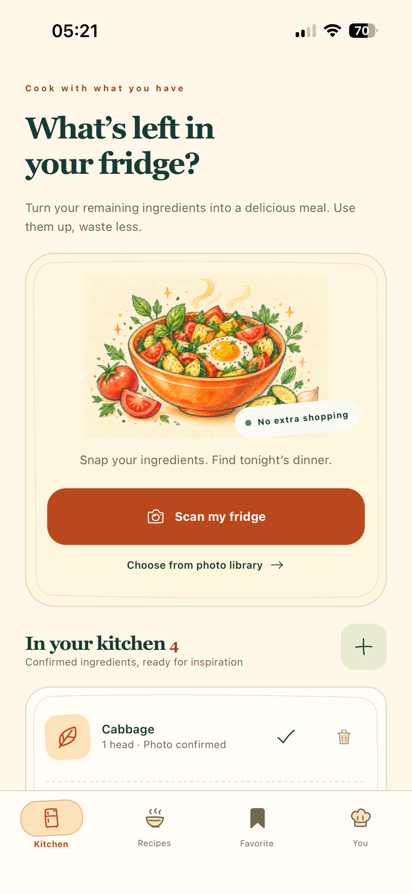</p>

## From fridge to dinner

Take or upload a fridge photo, review what the model recognized, and confirm names, quantities and units. Your confirmed kitchen inventory becomes the context for up to five cooked recipes that fit your dietary preferences and available time.

<p align="center">
  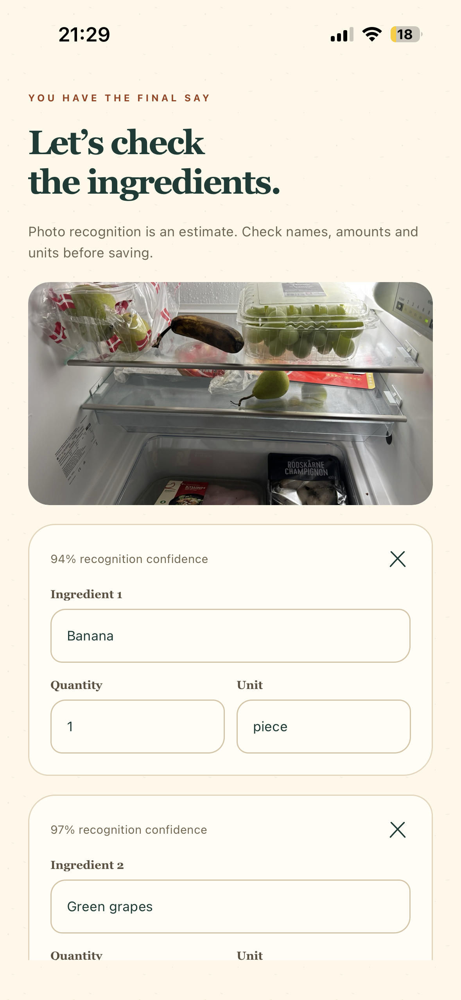
  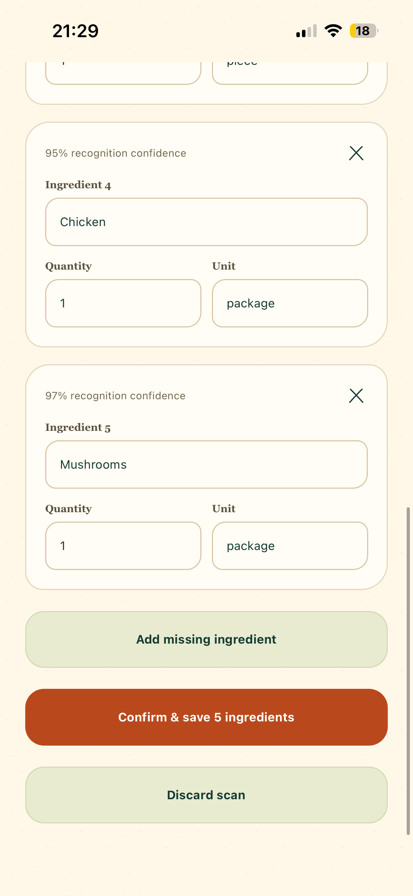
  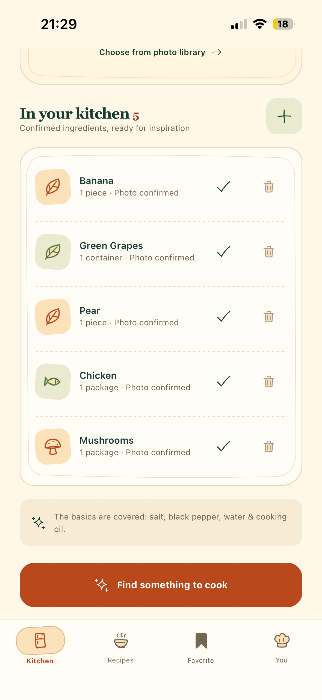
</p>
<p align="center"><sub>Review the photo · Confirm the ingredients · Find something to cook</sub></p>

## Keep the good ideas

Explore recipes with dish images and cooking steps. Save a favorite to revisit later. Generated images are stored and reused; opening the app again does not require another model generation for an already saved image. Offline ingredient and favorite deletions synchronize when the app reconnects and runs in the foreground.

<p align="center">
  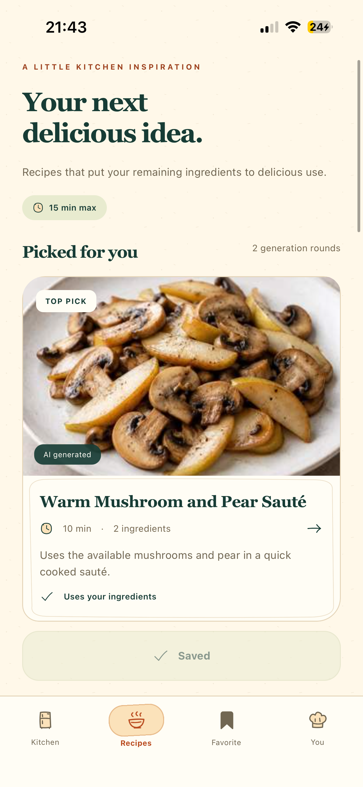
  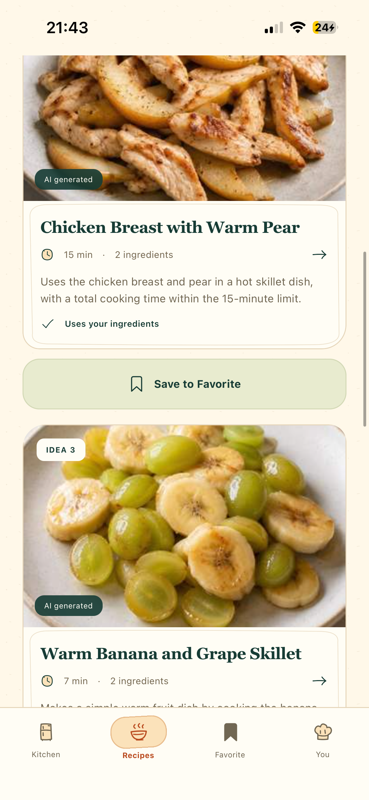
  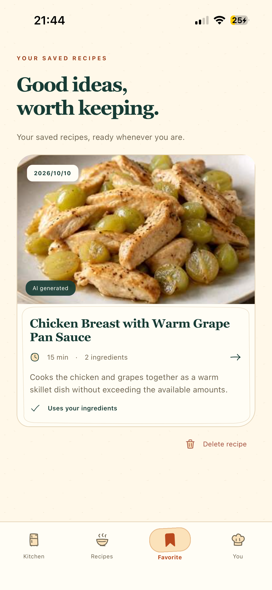
</p>
<p align="center"><sub>Explore ideas · Read the instructions · Keep a favorite</sub></p>

## Made for your kitchen

Choose dietary preferences and a maximum cooking time. A free allowance and two monthly subscription tiers make paid AI usage explicit. Purchasing uses Apple in-app purchases with RevenueCat subscription verification.

<p align="center">
  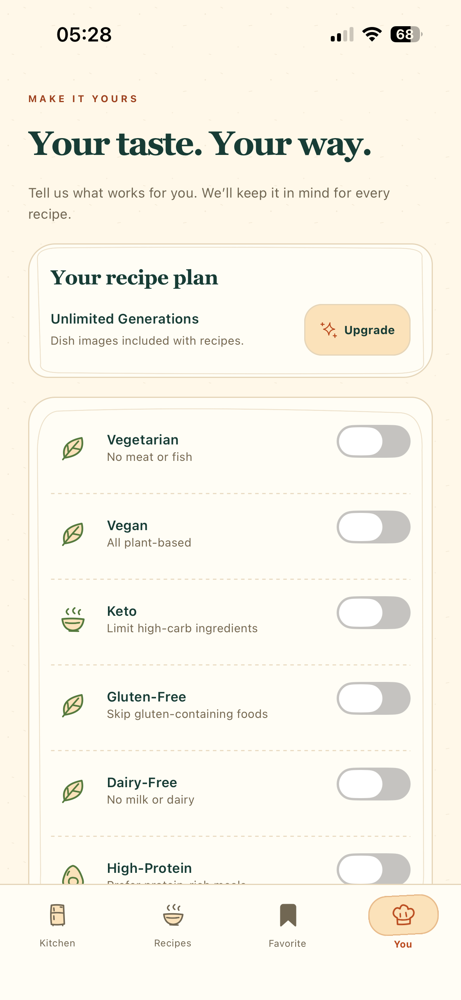
  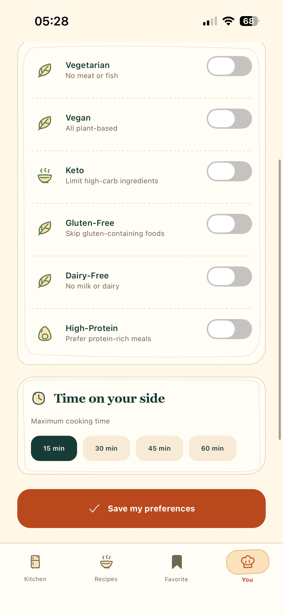
</p>

**Release status:** iOS distribution and purchase validation are in progress as of October 2026. 

## System boundaries

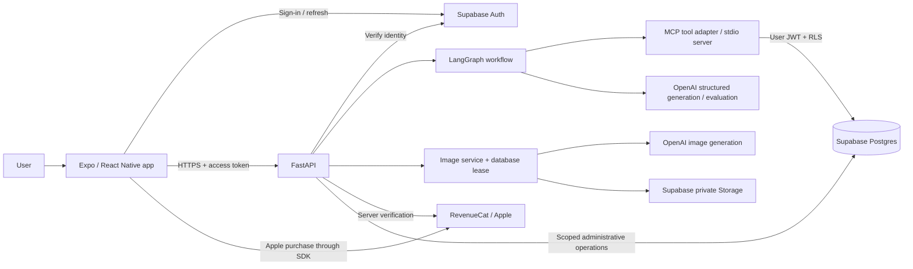

The image service, billing and accounting are separate from the recipe graph. They are API responsibilities, rather than capabilities the language model can freely invoke. Render hosts the backend. The administrative storage/accounting credential remains server-side; it bypasses RLS, so those paths need explicit ownership and operation checks.

## Component responsibilities

| Layer | Responsibility | What it should not decide |
| --- | --- | --- |
| Mobile app | Recognition review, kitchen edits, preferences, recipes, caches, purchase UI | Subscription authority or another account's data access |
| FastAPI | Authentication, input validation, jobs, quotas, images and billing coordination | Invented inventory when a tool fails |
| LangGraph | Load context, generate candidates, validate/evaluate, retry within bounds, rank | Arbitrary actions or unlimited retries |
| MCP tools | Typed inventory/preference/recipe operations using verified request identity | Accept a model-selected user ID as authorization |
| Postgres / RLS | Ownership isolation, durable state, atomic accounting and leases | Treat client state as proof of entitlement |
| Storage | Persist generated images and serve authorized signed URLs | Make all images publicly readable |

## Photo to recipe

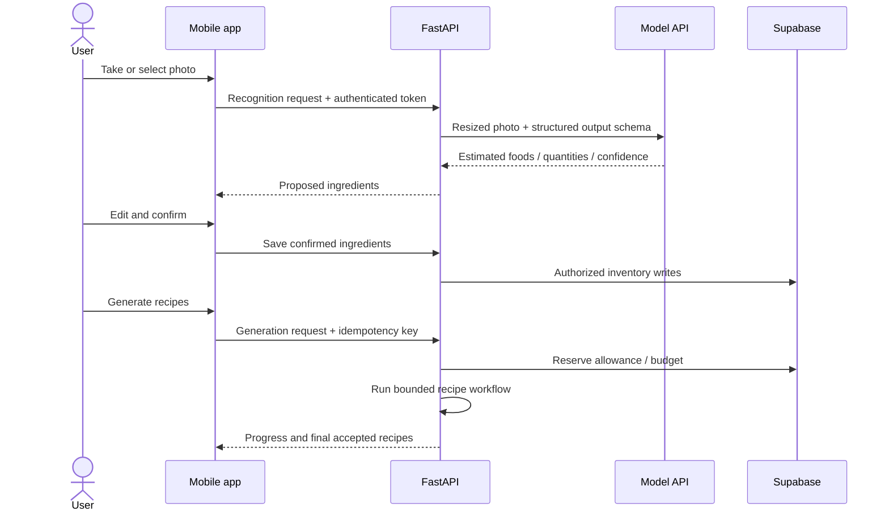

Recognition does not write inventory. Confirmation is the boundary between uncertain visual inference and application state. The current confirmation flow saves items individually; a partial network failure can leave some saved and some unsaved.

Accepted recipe progress is persisted in the generation job and polled by the app. Final completion still governs allowance accounting and when favorite/image operations become available. Progress is scoped to the authenticated owner; polling does not start another model call.

## Identity and data ownership

1. Supabase issues the user's session. Native session storage uses SecureStore; web sessions are kept in memory.
2. FastAPI verifies the access token rather than trusting a client-provided email or user ID.
3. The trusted request token is passed to the MCP process. MCP revalidates it; tool schemas do not take an arbitrary owner ID.
4. User data access combines ownership filtering with Postgres RLS. Recipe/session ownership also uses database constraints.
5. Backend-only accounting, cleanup and upload operations use a service credential with additional application/database authorization checks.

The recipe workflow uses inventory and preference reads. It does not call the inventory mutation tool. Naming a tool in an MCP server is not the same as granting the model autonomous access to it.

## Data lifecycle

| Data | Lifecycle |
| --- | --- |
| Confirmed inventory / preferences | Account-linked state, changed by user actions |
| Generated drafts | Current generation batch; inactive drafts are eligible for scheduled cleanup |
| Favorites | Explicitly saved by the user and retained until removal |
| Generated images | Private storage; reusable references and deletion cleanup queue |
| Mobile cache | Per-account local data and bounded generated-image cache |
| Pending deletions | Durable local tombstones until synchronized; completed tombstones also filter stale reads |
| AI usage / reservations | Backend-managed accounting; separate from recipe content |

Temporary drafts and favorites are separate records. A shared recipe read layer allows image and allowance logic to work with either. Deleting data can enqueue storage cleanup; a successful UI response is not proof that every physical object has already been erased.

## Operational trade-offs

- MCP provides a clear tool and identity boundary, but per-request subprocess work adds latency and deployment complexity. Direct typed repository calls would be a reasonable simpler alternative for a small service.
- Local caches improve repeat visits; signed URL expiration and account changes require invalidation. A missing cached file triggers a download, not necessarily another image generation.
- Progress polling is simpler to reconnect than a streaming connection, at the cost of repeated read requests.
- The graph runs in the API service; this is not a standalone durable worker system. Persistent jobs/leases help recovery but do not guarantee arbitrary work continues after process termination.


## Execution flow

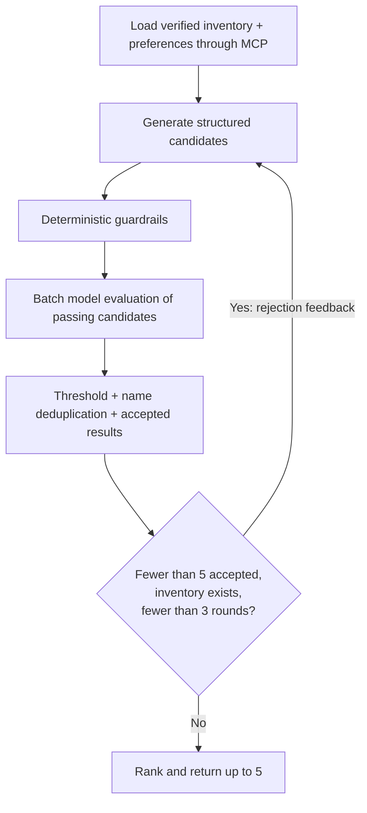

Empty or incompatible inventory can produce zero results. A tool failure propagates as an error; the system does not replace missing context with plausible ingredients. Accepted candidates from earlier rounds are retained and subsequent generation receives rejection feedback and accepted names.

## Four mechanisms with different jobs

| Mechanism | Runs when | What it establishes | What it cannot establish |
| --- | --- | --- | --- |
| Structured output schema | Recognition, generation and judge calls | Expected fields, types, ranges and shape | Truth, feasibility or ownership |
| Deterministic guardrails | Every generated candidate | Inventory quantities/units, approved pantry staples, dictionary restrictions, time and a cooking-action check | Every semantic ingredient mention or medically safe diets |
| Separate LLM judge call | Candidates passing hard rules | A model's assessment of feasibility, instructions and semantic violations | Guaranteed hallucination detection or ground-truth quality |
| Offline eval runner | Development / regression evaluation | Dataset-level behavior and reproducible comparisons | App-scale quality from a small fixture set |

### Run the public examples

Python 3.11+; no API keys, cloud account or third-party packages required:

```bash
python3 -m examples.recipe_constraints
python3 -m examples.offline_deletions
python3 -m unittest discover -s tests -v
```

These are deliberately simplified, runnable teaching examples inspired by the product. They demonstrate [cumulative inventory constraints](examples/recipe_constraints.py) and [account-scoped offline deletion](examples/offline_deletions.py). They do **not** implement the complete app, call a live model or reproduce the production security boundary. Example output is fixture evidence, not a live-model quality benchmark.


