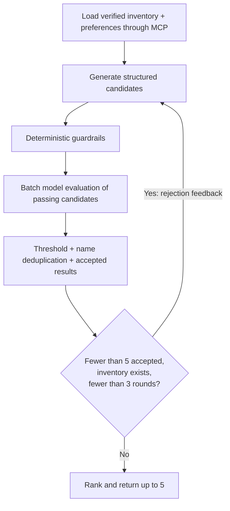

# A bounded AI workflow for real inventory

[Back to the showcase](../README.md)

The workflow is an AI agent application in the sense of a stateful, tool-connected, feedback-driven process. It is **not** a free-running multi-agent system. Application code controls graph transitions and tool calls; model output cannot authorize arbitrary actions.

## Execution flow

Empty or incompatible inventory can produce zero results. A tool failure propagates as an error; the system does not replace missing context with plausible ingredients. Accepted candidates from earlier rounds are retained and subsequent generation receives rejection feedback and accepted names.

## Four mechanisms with different jobs

| Mechanism | Runs when | What it establishes | What it cannot establish |
| --- | --- | --- | --- |
| Structured output schema | Recognition, generation and judge calls | Expected fields, types, ranges and shape | Truth, feasibility or ownership |
| Deterministic guardrails | Every generated candidate | Inventory quantities/units, approved pantry staples, dictionary restrictions, time and a cooking-action check | Every semantic ingredient mention or medically safe diets |
| Separate LLM judge call | Candidates passing hard rules | A model's assessment of feasibility, instructions and semantic violations | Guaranteed hallucination detection or ground-truth quality |
| Offline eval runner | Development / regression evaluation | Dataset-level behavior and reproducible comparisons | App-scale quality from a small fixture set |

### Guardrails

The product normalizes a limited set of names, aggregates stock by food/unit and accumulates all recipe usage before comparing it with available quantity. Matching units is mandatory: a bag is not silently converted into grams.

Dietary checks use a conservative dictionary. Unknown ingredients are rejected for restrictive diets because unknown classification is not evidence of compatibility. Known undeclared foods in instructions are also checked. Positive cooking verbs must appear in actual steps; no-cook titles and negated actions are rejected. Semantic heat-cooking still needs the judge because a verb such as “boil” could apply only to water.

The [public constraint example](../examples/recipe_constraints.py) isolates cumulative quantities and unit matching. It intentionally omits the product's diet dictionary, full instruction checks and model integration.

### LLM judge and hallucination checks

The evaluator receives each recipe, the inventory and preferences in a separate model call. It is instructed to reject unavailable additions in steps and dishes that do not meaningfully heat-cook an inventory ingredient. It scores five dimensions from 0 to 1:

1. Inventory utilization.
2. Dietary fit.
3. Recipe feasibility.
4. Cooking-time fit.
5. Instruction quality.

The prompt requests their mean as `overall_score`, with zero for specified semantic violations. The schema enforces score ranges, but the current implementation **does not recompute the mean server-side**. Selection trusts the returned overall score and requires at least 0.75. This is a known improvement opportunity, not a calibrated probability of correctness.

The generator and judge use the same configured text model in distinct calls. “Separate evaluation” means a separate task and call, not a statistically independent model. Shared-model blind spots can remain. Candidate indices are checked for missing or duplicate evaluations and restored to candidate order before selection.

### Offline evals

The private runner executes the graph on fixed inventories/preferences and reports:

- Case success: expected empty versus nonempty outcome.
- Dietary compliance and inventory constraints on final recipes.
- Hallucinated-ingredient proxy: deterministic unavailable, unapproved or undeclared ingredient failures.
- Average model evaluator score and the proportion of cases using more than one round.

This proxy is not a comprehensive semantic hallucination measure. Metrics on final accepted output can look good even if many candidates were rejected; they should be paired with rejection rates, result coverage, latency and human review. Demo fixtures validate plumbing and rules, while live-mode evals call the configured model. No live-model pass rate is asserted in this showcase.

## Why bounded regeneration?

Three rounds and a target of five cap cost and latency. Returning fewer useful recipes is preferable to filling a fixed quota with weak suggestions. The system ranks only accepted recipes and deduplicates normalized names; name-based deduplication does not guarantee semantic recipe diversity.

## Prompt injection and authority

Inventory names and photo text are treated as untrusted data in prompts. This is a model instruction, not a security guarantee. The stronger boundaries are code-controlled tools, authenticated identity propagation, RLS and server-owned quotas. Even a bad recipe proposal should not grant access to another account or allow the model to spend an unlimited budget.

## Next improvements to defend in an interview

- Compute overall scores deterministically from the five dimensions and handle explicit violation flags separately.
- Add human-labeled semantic violation cases and version prompt/model/configuration together.
- Measure rejected candidate quality, acceptance coverage and latency alongside final-output compliance.
- Test diversity beyond recipe-name equality and improve language/food normalization without guessing unsafe conversions.

These are proposed improvements, not features already claimed as shipped.
