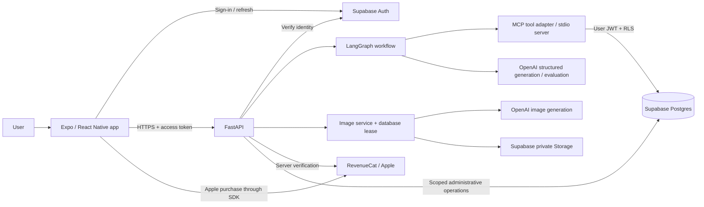
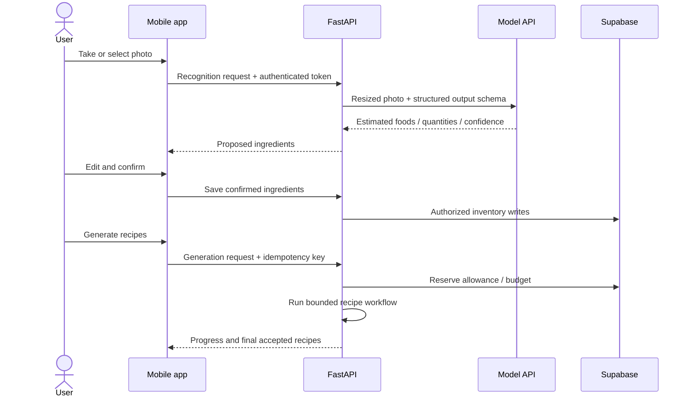

# FridgeOut architecture

[Back to the showcase](../README.md)

FridgeOut separates user decisions, model proposals and database authority. The model proposes a recipe; it does not authenticate a user, grant a subscription or modify inventory on its own.

## System boundaries

The image service, billing and accounting are separate from the recipe graph. They are API responsibilities, rather than capabilities the language model can freely invoke. Render hosts the backend. The administrative storage/accounting credential remains server-side; it bypasses RLS, so those paths need explicit ownership and operation checks.

## Component responsibilities

| Layer | Responsibility | What it should not decide |
| --- | --- | --- |
| Mobile app | Recognition review, kitchen edits, preferences, recipes, caches, purchase UI | Subscription authority or another account's data access |
| FastAPI | Authentication, input validation, jobs, quotas, images and billing coordination | Invented inventory when a tool fails |
| LangGraph | Load context, generate candidates, validate/evaluate, retry within bounds, rank | Arbitrary actions or unlimited retries |
| MCP tools | Typed inventory/preference/recipe operations using verified request identity | Accept a model-selected user ID as authorization |
| Postgres / RLS | Ownership isolation, durable state, atomic accounting and leases | Treat client state as proof of entitlement |
| Storage | Persist generated images and serve authorized signed URLs | Make all images publicly readable |

## Photo to recipe

Recognition does not write inventory. Confirmation is the boundary between uncertain visual inference and application state. The current confirmation flow saves items individually; a partial network failure can leave some saved and some unsaved.

Accepted recipe progress is persisted in the generation job and polled by the app. Final completion still governs allowance accounting and when favorite/image operations become available. Progress is scoped to the authenticated owner; polling does not start another model call.

## Identity and data ownership

1. Supabase issues the user's session. Native session storage uses SecureStore; web sessions are kept in memory.
2. FastAPI verifies the access token rather than trusting a client-provided email or user ID.
3. The trusted request token is passed to the MCP process. MCP revalidates it; tool schemas do not take an arbitrary owner ID.
4. User data access combines ownership filtering with Postgres RLS. Recipe/session ownership also uses database constraints.
5. Backend-only accounting, cleanup and upload operations use a service credential with additional application/database authorization checks.

The recipe workflow uses inventory and preference reads. It does not call the inventory mutation tool. Naming a tool in an MCP server is not the same as granting the model autonomous access to it.

## Data lifecycle

| Data | Lifecycle |
| --- | --- |
| Confirmed inventory / preferences | Account-linked state, changed by user actions |
| Generated drafts | Current generation batch; inactive drafts are eligible for scheduled cleanup |
| Favorites | Explicitly saved by the user and retained until removal |
| Generated images | Private storage; reusable references and deletion cleanup queue |
| Mobile cache | Per-account local data and bounded generated-image cache |
| Pending deletions | Durable local tombstones until synchronized; completed tombstones also filter stale reads |
| AI usage / reservations | Backend-managed accounting; separate from recipe content |

Temporary drafts and favorites are separate records. A shared recipe read layer allows image and allowance logic to work with either. Deleting data can enqueue storage cleanup; a successful UI response is not proof that every physical object has already been erased.

## Operational trade-offs

- MCP provides a clear tool and identity boundary, but per-request subprocess work adds latency and deployment complexity. Direct typed repository calls would be a reasonable simpler alternative for a small service.
- Local caches improve repeat visits; signed URL expiration and account changes require invalidation. A missing cached file triggers a download, not necessarily another image generation.
- Progress polling is simpler to reconnect than a streaming connection, at the cost of repeated read requests.
- The graph runs in the API service; this is not a standalone durable worker system. Persistent jobs/leases help recovery but do not guarantee arbitrary work continues after process termination.

See [failure scenarios](ENGINEERING_CHALLENGES.md) and [AI-specific decisions](AI_WORKFLOW.md).
